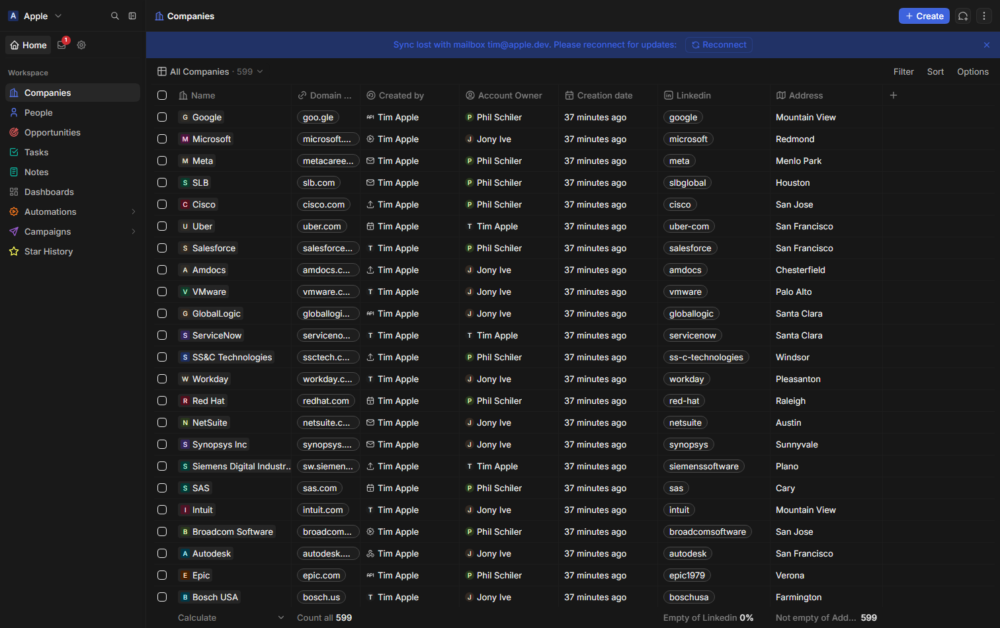

# Roster

A CRM whose schema you own: custom objects, custom views, workflows and agents, in a workspace you run.

<p align="center">
  <picture>
    <source media="(prefers-color-scheme: dark)" srcset="./docs/roster_dark.svg">
    <source media="(prefers-color-scheme: light)" srcset="./docs/roster.svg">
    
  </picture>
</p>

<p align="center">
  <a href="https://github.com/Dxlxz/roster/actions/workflows/ci.yml"></a>
  
  
  
</p>

<p align="center">
  
</p>

---

Most CRMs make you fit your business into their objects. Roster treats the **schema as data**: you add objects,
fields, relations, views and permissions at runtime, and the API, the UI and the agents all follow.

It is the business application of a stack: [Tessera](https://github.com/Dxlxz/tessera) builds pipelines,
[Lintel](https://github.com/Dxlxz/lintel) guards them, [Quorum](https://github.com/Dxlxz/quorum) runs agents on
top, [Beacon](https://github.com/Dxlxz/beacon) watches it — and Roster is where the customer data those systems act
on actually lives.

## What you get

| | |
|---|---|
| **Custom objects and fields** | Add a `Contract` object with a `renewalDate` and the table view, kanban, filters, API and permissions exist for it immediately |
| **Views you define** | Table, kanban and calendar, saved as records with their own fields, filters, sort and grouping |
| **Relations** | Many-to-one, one-to-many and self-relations across your own objects, with rollups |
| **Workflows** | Trigger → filter → action on record events, without a second service |
| **Agents and AI** | Ask in the record view; the agent works against the workspace schema, not a hardcoded prompt |
| **API first** | GraphQL and REST generated from the metadata, plus an SDK and a CLI for building apps on top |
| **Roles and permissions** | Per-object and per-field permissions, multi-workspace, SSO on the enterprise track |
| **Keyboard-first** | Command menu, inline editing, no modal maze |

## Run it

With Docker (Postgres and Redis included):

```shell
git clone https://github.com/Dxlxz/roster.git
cd roster/packages/roster-docker

docker compose up -d
```

The app comes up on <http://localhost:3001>; sign up for the first workspace there.

From source:

```shell
cd roster
node .yarn/releases/yarn-4.18.1.cjs install
node .yarn/releases/yarn-4.18.1.cjs nx run roster-front:build

cd packages/roster-server
node ../../.yarn/releases/yarn-4.18.1.cjs start
```

Requires Node 22.14 or newer; Postgres 16 and Redis for the server. `packages/roster-server/.env` holds the
connection strings — one file, no secrets in code.

## Layout

| Package | What it is |
|---|---|
| `roster-server` | NestJS API: metadata engine, GraphQL, REST, workflows, auth, queues |
| `roster-front` | React app: views, record pages, workflow editor, settings |
| `roster-ui` | The component library the front is built from (its own Storybook) |
| `roster-shared` | Types, metadata helpers and constants shared by both sides |
| `roster-sdk`, `roster-client-sdk` | Typed clients for apps built on the API |
| `roster-cli` | App scaffolding and workspace tooling |
| `roster-emails` | Transactional templates |
| `roster-docker` | Compose, Helm, k8s and the production Dockerfile |

## Working on it

```shell
node .yarn/releases/yarn-4.18.1.cjs install
node .yarn/releases/yarn-4.18.1.cjs nx run-many -t test --projects=roster-shared   # unit tests
node .yarn/releases/yarn-4.18.1.cjs nx run-many -t lint
```

Nx caches per project, so a change to `roster-shared` rebuilds what consumes it and nothing else. The server and
the front are separate deploys; the metadata contract between them is versioned in `roster-shared`.

## Where this is going

- [ ] Object-level audit trail (who changed what, exportable)
- [ ] Field-level encryption for PII, declared in the metadata
- [ ] Import mapping UI: CSV → any object, with a dry run
- [ ] Reusable view templates across workspaces

## License and lineage

AGPL-3.0 (with the enterprise-marked files under a commercial license) — see [LICENSE](./LICENSE) and
[NOTICE](./NOTICE).

Roster is developed from the roster codebase (AGPL-3.0). The package names, npm scope (`@roster/`), environment
prefix (`ROSTER_*`), brand assets, README and CI were rebuilt; the Node engine range was widened to the LTS line.
Upstream copyright is retained.
